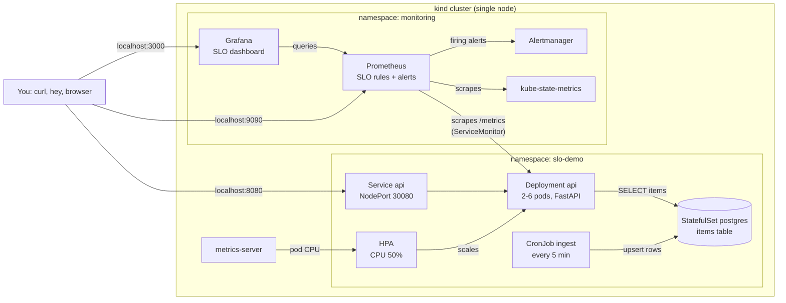
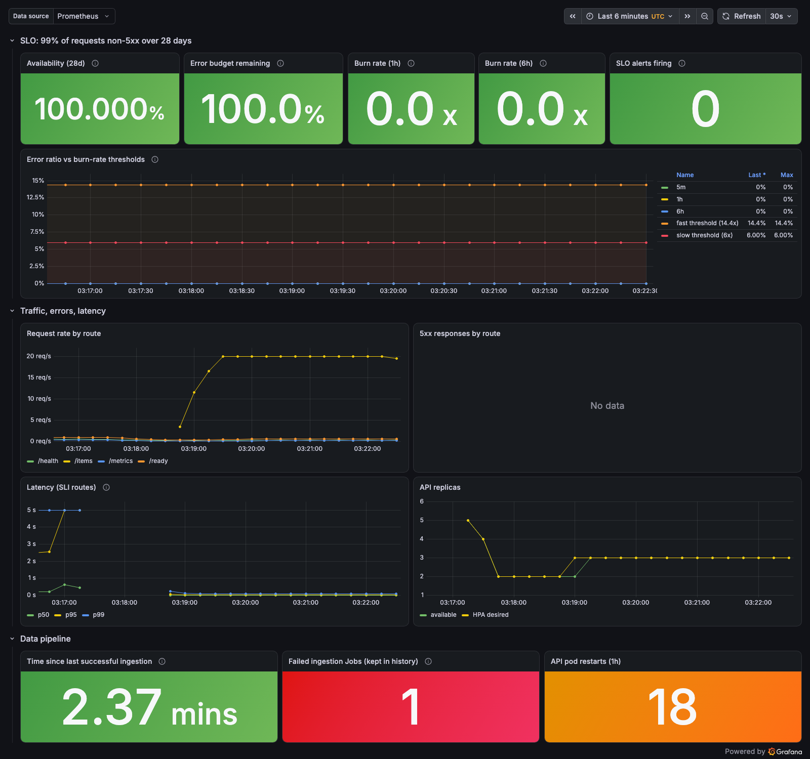

# k8s-slo-pipeline-demo

[](https://github.com/santinocc/k8s-slo-pipeline-demo/actions/workflows/ci.yml)

A hands-on **learning project** that runs a small Python API, a scheduled data
pipeline, and SLO-based monitoring on a local Kubernetes cluster (kind).
Everything runs on a laptop; no cloud resources are used. It is not production
software, and nothing here has been used in production.

What it covers:

- **API:** FastAPI service with health, readiness, data, and Prometheus metrics
  endpoints, packaged as a non-root container image.
- **Kubernetes:** Deployment with probes and zero-downtime rolling updates,
  Service, ConfigMap, Secret (created from `.env`, never committed), and a
  HorizontalPodAutoscaler.
- **Data pipeline:** a CronJob that upserts generated sensor data into
  PostgreSQL every 5 minutes. It is safe to re-run, and failures retry with a
  visible failed Job.
- **Observability:** kube-prometheus-stack (Prometheus, Alertmanager, Grafana),
  a ServiceMonitor, and a Grafana dashboard committed as JSON.
- **SLO:** 99% of requests non-5xx over 28 days, with fast and slow
  multi-window burn-rate alerts, tested with promtool and shown firing and
  clearing in a recorded demo.

## Architecture



| Path | Contents |
|---|---|
| [`app/`](app/) | FastAPI service, tests, Dockerfile |
| [`pipeline/`](pipeline/) | Ingestion script for the CronJob, tests, Dockerfile |
| [`k8s/base/`](k8s/base/) | Kustomize manifests: Postgres, API, HPA, CronJob, Secret example |
| [`monitoring/`](monitoring/) | Helm values, ServiceMonitor, PrometheusRule, Grafana dashboard, rule tests |
| [`slo/slo.yaml`](slo/slo.yaml) | The SLO definition: objective, window, SLI queries, alert parameters |
| [`terraform/`](terraform/) | Optional Terraform for the kind cluster and Helm releases |
| [`kind/kind-config.yaml`](kind/kind-config.yaml) | Cluster config with a pinned node image and localhost port mappings |
| [`scripts/`](scripts/) | Verification scripts used by the Makefile |
| [`docs/`](docs/) | [Decision records](docs/decisions.md), [visual walkthrough](docs/walkthrough.md), [alert runbook](docs/runbook-slo-burn-rate.md), [SLO alert demo](docs/slo-alert-demo.md) with screenshots |

## Prerequisites

| Tool | Version used | Needed for |
|---|---|---|
| Docker (Docker Desktop on macOS) | 20.10 | Everything. Give it at least **4 CPUs and 4 GB of memory**. |
| [kind](https://kind.sigs.k8s.io/) | 0.33 | Local cluster |
| kubectl | 1.37 | Cluster access (within one minor version of the cluster, v1.37) |
| [Helm](https://helm.sh/) | 4.3 | metrics-server and kube-prometheus-stack |
| Python | 3.12 | Tests and lint (`make test` creates a virtualenv) |
| make, curl, openssl | any recent | Makefile targets |
| [hey](https://github.com/rakyll/hey) | any | HPA load test and the SLO alert demo |
| [kubeconform](https://github.com/yannh/kubeconform) | 0.8 | `make validate` |
| [Terraform](https://developer.hashicorp.com/terraform) (optional) | 1.17 | The [Terraform alternative](#alternative-create-the-cluster-with-terraform) to `make cluster` and `make monitoring` |

On macOS with Homebrew:

```bash
brew install kind helm kubernetes-cli kubeconform hey python@3.12
```

On Linux, install the same tools with your package manager or from each
project's release page.

The default ports are 8080 (API), 9090 (Prometheus), and 3000 (Grafana) on
`127.0.0.1`. They must be free.

## Quick start

From a clean clone this took under 5 minutes on an M1 laptop with the container
images already downloaded. Expect 10–15 minutes on a first run, mostly image
downloads.

```bash
git clone https://github.com/santinocc/k8s-slo-pipeline-demo.git
cd k8s-slo-pipeline-demo
```

Create the cluster, then build and deploy the API, PostgreSQL, and the CronJob:

```bash
make cluster deploy
```

`make deploy` creates a git-ignored `.env` from `.env.example` with random
passwords, and creates the Kubernetes Secret from it. No credentials are stored
in the repository.

Run lint and the unit tests:

```bash
make test
```

Install monitoring (kube-prometheus-stack, the ServiceMonitor, the SLO rules,
and the dashboard):

```bash
make monitoring
```

Prometheus starts scraping the API about 1–2 minutes after `make monitoring`
finishes, once the operator has reloaded its configuration. Then open:

- API: <http://localhost:8080/items> (the CronJob fills it within 5 minutes; `make ingest-now` runs it immediately)
- Grafana dashboard: <http://localhost:3000/d/slo-demo-api> (read-only without a login; the admin password is `GRAFANA_ADMIN_PASSWORD` in `.env`)
- Prometheus alerts: <http://localhost:9090/alerts>

Run `make help` to list every target.

## How to verify each milestone

Each check either prints PASS or fails with a non-zero exit code.

On every push and pull request, [GitHub Actions](.github/workflows/ci.yml) runs
`make test`, `make test-integration`, `make test-rules`, `make build`,
`make image-size`, `make tf-check`, and `make validate` (against a throwaway
kind cluster). The
cluster demos (`rollout-check`, `load-test`, the pipeline checks, and
`slo-alert-demo`) run only locally.

| Milestone | Command | What it shows |
|---|---|---|
| API and image | `make test` | Lint, format check, and unit tests (API, pipeline, SLO rule consistency) |
| | `make test-integration` | Pipeline upserts against a throwaway PostgreSQL container |
| | `make image-size` | Both images under 200 MB; both run as UID 10001 |
| | `curl localhost:8080/health` `/ready` `/items` `/metrics` | Endpoints return 200 |
| Cluster and deployment | `make status` | 2 API replicas Ready, Postgres Ready, CronJob scheduled |
| | `make validate` | Manifests pass kubeconform and `kubectl apply --dry-run=client` |
| | `make rollout-check` | Restarts the API under a curl loop: zero non-200 responses |
| | `make load-test` | HPA scales from 2 to at least 4 replicas under load, then back to 2 (about 6 minutes) |
| Data pipeline | `make pipeline-check` | Two runs in a row: still 50 unique rows, nothing inserted twice |
| | `make pipeline-fail-demo` | Wrong DB password: Job fails with `BackoffLimitExceeded` after 1 attempt plus 3 retries |
| Monitoring and SLO | `make test-rules` | promtool checks and unit-tests the alert rules |
| | `make slo-alert-demo` | Injects about 25% errors via `/chaos` until `SLOErrorBudgetBurnFast` fires, then recovers until it clears (about 12 minutes). The [runbook](docs/runbook-slo-burn-rate.md) says how to respond |

The SLO alert demo from 2026-11-03, with a timeline and screenshots, is in
[docs/slo-alert-demo.md](docs/slo-alert-demo.md). Screenshots of the running
cluster, Prometheus, the Grafana dashboard (healthy and overloaded), and CI are
in [docs/walkthrough.md](docs/walkthrough.md).



## Alternative: create the cluster with Terraform

[`terraform/`](terraform/) builds the same platform as `make cluster` plus
`make monitoring`: the kind cluster, metrics-server, and kube-prometheus-stack.
It reads the same `kind/kind-config.yaml` and Helm values files, so the two
paths cannot drift apart. No cloud provider is used, and the state stays local
(git-ignored). Use one path or the other on a given cluster, not both.

```bash
brew install hashicorp/tap/terraform
```

```bash
make tf-plan tf-apply
```

```bash
make deploy monitoring-manifests
```

Terraform generates the Grafana admin password; read it with
`terraform -chdir=terraform output -raw grafana_admin_password`. The kind
provider also writes a kubeconfig with the cluster credentials to
`terraform/slo-demo-config`. It is git-ignored, like the state and plan files.
To remove everything:

```bash
make tf-destroy
```

On 2026-11-05 this took 167 s for `tf-apply`, 77 s for the app, and 31 s for
`tf-destroy`. A second `terraform plan` after the apply showed no changes. The
reasons for the split between Terraform and Kustomize are in
[ADR-006](docs/decisions.md#adr-006-use-terraform-for-the-cluster-and-helm-releases-kustomize-for-the-app).

## Tear down

```bash
make teardown
```

This deletes the kind cluster and everything in it, including the PostgreSQL
volume. Your `.env` file and the local Docker images remain. Delete them with
`rm .env` and `docker rmi slo-demo-api:dev slo-demo-pipeline:dev`.

## Known limitations

These are deliberate simplifications for a local learning setup:

- Single node: no node failure, scheduling spread, or real horizontal capacity gain.
- PostgreSQL is a single StatefulSet pod with no replication or backups.
- API readiness depends on the database. If PostgreSQL is down, every API pod
  leaves the Service at once and clients get connection errors instead of 503s.
- `/chaos` exists only for the SLO demo and is off unless `CHAOS_ENABLED=true`.
- Grafana allows anonymous read-only access, and metrics-server skips kubelet
  TLS verification. Both are acceptable only on a local cluster.
- kube-prometheus-stack is trimmed to fit 4 CPUs and 4 GB (see
  [ADR-005](docs/decisions.md#adr-005-trim-kube-prometheus-stack-to-fit-a-4-cpu--4-gb-cluster)),
  so there are no default cluster-health alerts or node dashboards.
- The SLI only counts responses the API sent. Timeouts and requests that hit a
  restarting pod are not counted, so an overloaded cluster can still show 100%
  (see [the walkthrough](docs/walkthrough.md#5-grafana-dashboard-overloaded)).
- With monitoring installed, `make load-test` can overload a 4 CPU node: the
  API server stops answering and the test fails, then the cluster recovers.
- A new cluster has only minutes of data, so the 28-day availability and error
  budget panels show extreme values after the demo.

## What I learned

### The short version (explained to a 10-year-old)

Imagine a lemonade stand run by robots.

- **The robots (the API)** hand out lemonade when people ask. There are always
  at least 2. When a crowd shows up, more robots join automatically (up to 6),
  and they go rest when the crowd leaves. When the robots learn a new trick,
  they are swapped one at a time, so the stand never closes.
- **The delivery truck (the CronJob)** brings a list of 50 lemons to the
  storage room (PostgreSQL) every 5 minutes. If it comes twice by accident, it
  does not stack up double lemons. If it breaks down, it tries 3 more times and
  then raises a red flag so someone notices.
- **The promise (the SLO)** is "99 out of every 100 people get their
  lemonade." That leaves an oops allowance of 1 in 100.
- **The smart alarm (burn-rate alerts)** does not ring when one cup spills. It
  rings when the oops allowance is being used up far too fast. I tested it by
  making the robots spill on purpose: it rang after about 4 minutes and went
  quiet about 4.5 minutes after the spilling stopped.
- **The scoreboard (Grafana)** shows how many people got lemonade, how fast,
  and how much oops allowance is left.
- **The instruction book (this README)** lets anyone build the same stand on
  their own laptop in a few minutes.

Before, there was one robot, no backup, and no alarm: you would only find out
something was wrong when thirsty people walked away. Real services work the
same way as this practice stand, just much bigger.

### The details

- **Readiness and liveness answer different questions.** Liveness (`/health`)
  only checks the process, so a database outage does not cause a restart loop.
  Readiness (`/ready`) checks the database, so traffic stops reaching pods that
  cannot serve it. The trade-off is that all pods become unready together when
  the database is down.
- **Zero-downtime rollouts need more than `maxUnavailable: 0`.** A short
  `preStop` pause lets the Service remove the pod's endpoint before uvicorn
  stops. Testing through `kubectl port-forward` gave misleading failures,
  because port-forward is tied to one pod.
- **Idempotent pipelines are easier to operate.** Deriving the data from the
  item id and the time window, and upserting with "skip unchanged rows", means a
  retry or manual re-run is always safe, and the logs show exactly what changed.
- **Burn-rate alerts behave better than error-rate thresholds.** In the demo the
  fast alert fired about 4 minutes after errors started, and cleared about
  4.5 minutes after they stopped, while the 1-hour error ratio was still 20%.
  The short window is what makes it clear quickly.
- **Test the alert rules like code.** promtool unit tests, and a check that the
  rules match `slo/slo.yaml`, caught mistakes before anything was deployed.
- **An SLI only sees what it measures.** Under overload, pods restarted 17
  times and p99 latency reached 5 seconds, yet availability stayed at 100%,
  because requests that never got a response were never counted. Measuring
  from the client side and adding a latency SLO would close that gap.
- **Monitoring has a resource cost.** The default kube-prometheus-stack
  overloaded a 4 CPU / 4 GB cluster until the control plane restarted in a loop.
  Choosing what to scrape and evaluate is part of the design.

## What I would do in production

This project stops at a local cluster. On AWS, the same design would change like this:

- **Cluster:** Amazon EKS with managed node groups or Karpenter across several
  Availability Zones, PodDisruptionBudgets, topology spread constraints, and
  NetworkPolicies. Cluster and add-ons would be managed with Terraform (the
  same split as the local `terraform/`, with the AWS provider and remote state
  in S3), and workloads deployed through GitOps (Argo CD or Flux).
- **Identity and secrets:** IRSA or EKS Pod Identity, so pods get short-lived AWS
  credentials without static keys. Secrets would live in AWS Secrets Manager and
  be synced with the External Secrets Operator, instead of a `.env` file.
- **Database:** Amazon RDS or Aurora PostgreSQL (Multi-AZ, automated backups,
  point-in-time recovery) instead of a StatefulSet. The API would connect
  through RDS Proxy or PgBouncer.
- **Images and delivery:** Amazon ECR with immutable tags and image scanning.
  The CI workflow here already runs lint, tests, validation, and the image
  build; in production it would also scan, sign, and push the images. Rollouts would be progressive (Argo Rollouts canary gated on the SLO).
- **Traffic:** AWS Load Balancer Controller with an ALB, TLS from ACM, and a WAF
  in front.
- **Observability:** Amazon Managed Service for Prometheus and Amazon Managed
  Grafana, or self-hosted Prometheus with long-term storage (Thanos or Mimir).
  The default cluster rules and dashboards would stay on.
- **Alert routing:** Alertmanager routes by severity: `page` to an on-call tool
  (PagerDuty or Opsgenie) and `ticket` to a team channel or issue queue. The
  alerts here already link to [a runbook](docs/runbook-slo-burn-rate.md)
  through `runbook_url`; there would also be a separate "no traffic" alert.
- **Pipeline:** keep the CronJob for simple single-step jobs. Use Airflow (MWAA),
  Argo Workflows, or Step Functions once there are dependencies, backfills, or
  lineage requirements.

## Decisions

The reasons behind the main choices are in [docs/decisions.md](docs/decisions.md):
why kind, why Python and FastAPI, why burn-rate alerts, why a CronJob over
Airflow, why the monitoring stack is trimmed, and what Terraform manages.

## License

[MIT](LICENSE)
