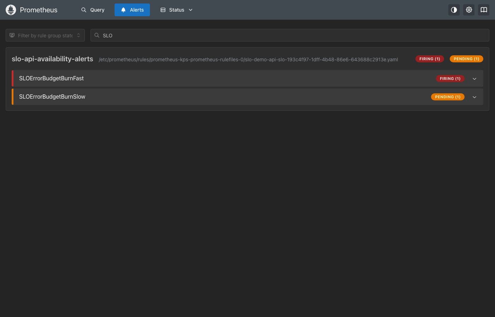
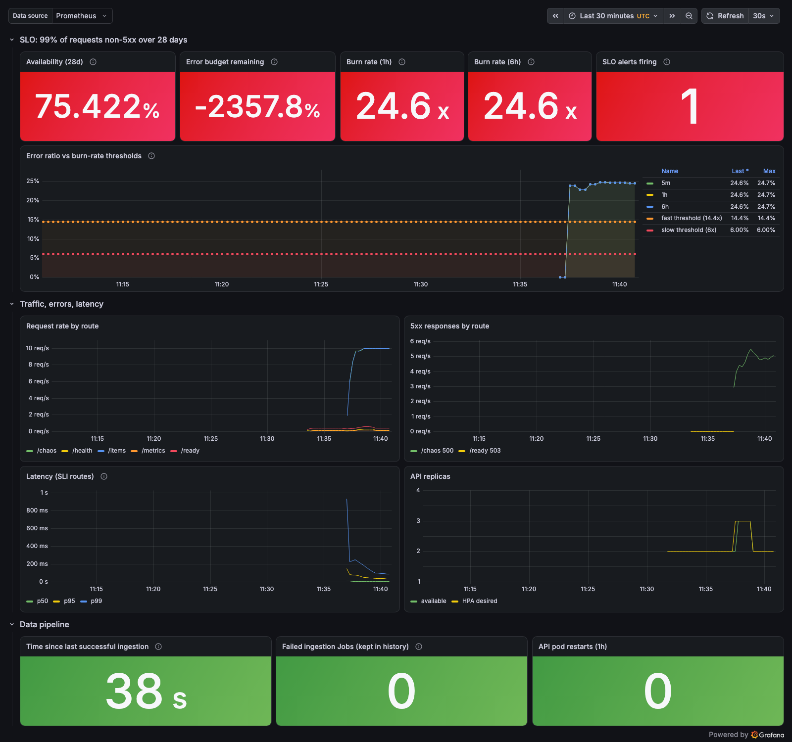
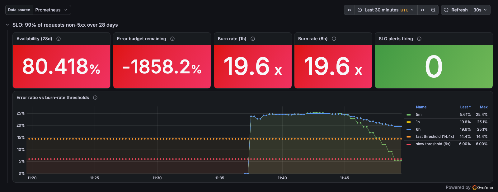

# SLO burn-rate alert demo (M4)

Recorded on 2026-11-03 on a fresh local kind cluster with `make slo-alert-demo`.
This is a learning project; the numbers below come from a short demo, not production traffic.

## What the demo does

1. Turns on the `/chaos` endpoint (`CHAOS_ENABLED=true`) with a rolling update.
2. Sends about 10 req/s to `/items` and 10 req/s to `/chaos?rate=0.5`, so roughly
   25% of SLI requests return 500. That is a burn rate of about 25x against a 1% error budget.
3. Waits for `SLOErrorBudgetBurnFast` to fire, keeps the errors going for 4 minutes,
   then stops them while normal traffic continues.
4. Waits for the alert to clear, then turns `/chaos` off again.

## Timeline

| Time (UTC) | Event | 5m error ratio | 1h error ratio |
|---|---|---|---|
| 11:36:34 | Error injection starts | – | – |
| 11:38:36 | Alert pending (both windows above 14.4%, waiting out `for: 2m`) | 22.9% | 22.9% |
| 11:40:37 | **Alert firing**, 243 s after errors started | 24.6% | 24.6% |
| 11:44:37 | Error injection stops | 24.8% | 24.8% |
| 11:48:39 | Still firing: the 5m window still holds the failing requests | 12.2% | 20.6% |
| 11:49:09 | **Alert cleared**, 272 s after errors stopped | 9.1% | 20.1% |

The alert cleared while the 1h error ratio was still at 20%. That is the point of
the short window: the long window shows the budget burn was significant, the short
window shows it is still happening, and the alert needs both.

`SLOErrorBudgetBurnSlow` (6h and 30m windows above 6%, for 15m) went to pending but
did not fire during the 8 minutes of errors.

## Screenshots

Alert firing in Prometheus (fast alert firing, slow alert pending):

Grafana dashboard during the incident. The error ratio is about 25%, above the 14.4%
fast-burn threshold:

After recovery: the 5m ratio has dropped below the thresholds, and no SLO alerts are firing:

The "Availability" and "Error budget remaining" values look extreme because a new
cluster has only a few minutes of data. Over a real 28-day window, 8 minutes at 25%
errors would use about 5% of the error budget.
