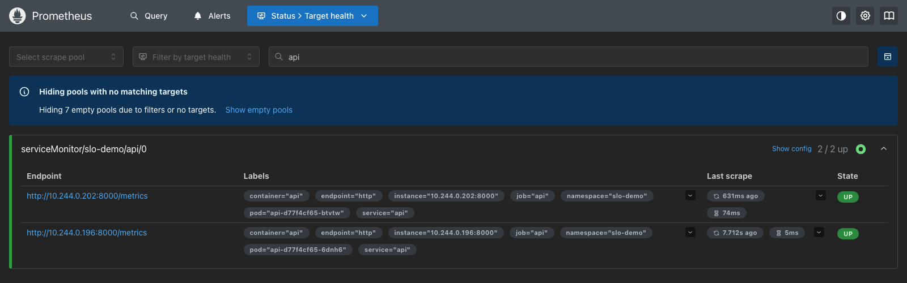
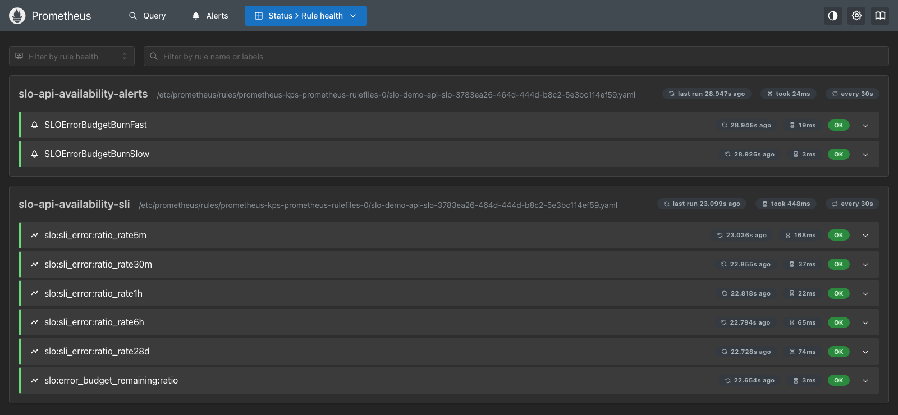
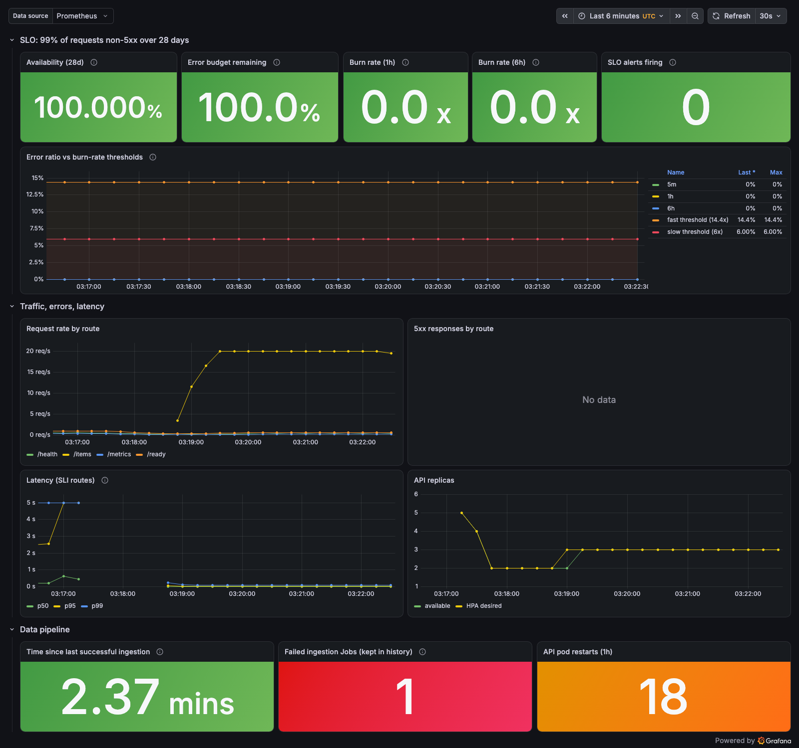
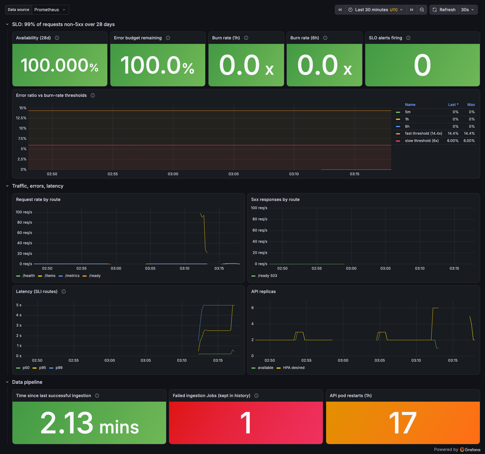
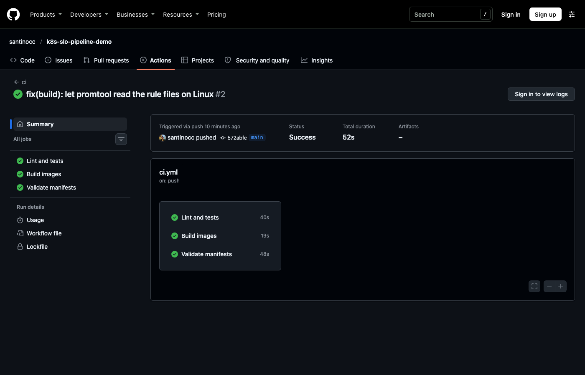

# Visual walkthrough

Screenshots and terminal output from the running project on 2026-11-05, on a
single-node kind cluster (Docker Desktop with 4 CPUs and 4 GB) on an M1
laptop. This is a learning project; the numbers describe this laptop only.

The SLO alert firing and clearing is shown separately in
[slo-alert-demo.md](slo-alert-demo.md).

## 1. The cluster and the app

One kind node runs everything. The API has 2 replicas (the HPA minimum),
PostgreSQL is a StatefulSet, and the `ingest` CronJob runs every 5 minutes.

```text
$ kubectl get nodes
NAME                     STATUS   ROLES           AGE   VERSION
slo-demo-control-plane   Ready    control-plane   17h   v1.37.0

$ kubectl -n slo-demo get deploy,statefulset,cronjob,hpa
NAME                  READY   UP-TO-DATE   AVAILABLE   AGE
deployment.apps/api   2/2     2            2           17h

NAME                        READY   AGE
statefulset.apps/postgres   1/1     17h

NAME                   SCHEDULE      TIMEZONE   SUSPEND   ACTIVE   LAST SCHEDULE   AGE
cronjob.batch/ingest   */5 * * * *   Etc/UTC    False     0        3m35s           17h

NAME                                      REFERENCE        TARGETS        MINPODS   MAXPODS   REPLICAS   AGE
horizontalpodautoscaler.autoscaling/api   Deployment/api   cpu: 26%/50%   2         6         2          17h
```

The API serves the rows the pipeline wrote:

```text
$ curl -s "localhost:8080/items?limit=3"
[{"id":1,"name":"sensor-001","category":"temperature","value":22.09,"updated_at":"2026-11-05T03:15:48.653365Z"},
 {"id":2,"name":"sensor-002","category":"humidity","value":45.97,"updated_at":"2026-11-05T03:15:48.653365Z"},
 {"id":3,"name":"sensor-003","category":"pressure","value":1013.07,"updated_at":"2026-11-05T03:15:48.653365Z"}]
```

Each pipeline run logs exactly what it changed. A new 5-minute window updates
all 50 rows; a re-run in the same window would report `unchanged=50`:

```text
$ kubectl -n slo-demo logs job/ingest-29897475
2026-11-05 03:15:48,752 INFO ingest ingestion complete window=2026-11-05T03:15:00+00:00 rows=50 inserted=0 updated=50 unchanged=0 duration_ms=304
```

## 2. Prometheus finds the API through the ServiceMonitor

Both API pods are discovered and scraped (`2 / 2 up`). Nobody listed the pod
IPs by hand: the ServiceMonitor selects the `api` Service, and Prometheus
follows the pods as they are replaced or scaled.



## 3. The SLO rules are loaded

The PrometheusRule from [`monitoring/slo-rules.yaml`](../monitoring/slo-rules.yaml)
is loaded as two groups, evaluated every 30 seconds: the error-ratio
recording rules for each window, and the two burn-rate alerts.



## 4. Grafana dashboard: healthy

About 20 requests per second on `/items` for 4 minutes (`hey -z 240s -c 4 -q 5`):
4,800 responses, all `200`.

- The SLO row is all green: 100% availability, full error budget, burn rate 0.
- No 5xx responses, and p99 latency stays at about 100 ms or less.
- The HPA added a third pod as CPU rose, and the pipeline last succeeded
  about 2 minutes earlier.

The "Failed ingestion Jobs" panel shows 1 because the failed Job from
`make pipeline-fail-demo` is kept in the CronJob history on purpose. The
restart count comes from the overload shown next.



## 5. Grafana dashboard: overloaded

`make load-test` sends 50 concurrent connections for 3 minutes. Before
monitoring was installed, this passed: the HPA scaled from 2 to 6 pods and
back. With the monitoring stack and a headless browser also running on the
same 4 CPUs, the node ran out of capacity:

- The HPA scaled to 6 pods (03:12), but the Kubernetes API server stopped
  answering (`TLS handshake timeout`), so the test script failed.
- API pods failed their liveness probes and restarted (17 restarts in an hour),
  and the Prometheus operator crash-looped until the API server came back.
- p99 latency reached 5 seconds, and the graphs have gaps where Prometheus
  could not scrape.

**The SLO still shows 100% availability.** The SLI counts 5xx responses
that the API sent. Requests that timed out, or reached a pod while it was
restarting, never produced a response, so the API never recorded them.
A real service would also measure from the client side (load balancer
metrics or a synthetic probe), and add a latency SLO.

Everything recovered on its own within about 5 minutes once the load stopped.



## 6. CI on GitHub Actions

Every push runs lint, unit and integration tests, the promtool rule tests,
the image build with the size and non-root check, and manifest validation
against a throwaway kind cluster. See [`.github/workflows/ci.yml`](../.github/workflows/ci.yml).


